# valueprobe

**Open-source, local-first intrinsic-value calculator.** Discounted cash flow, margin of safety,
reverse DCF, a per-share history table and a valuation trail — with the formula kernel ported
line by line and pinned by tests.

<p align="center">
  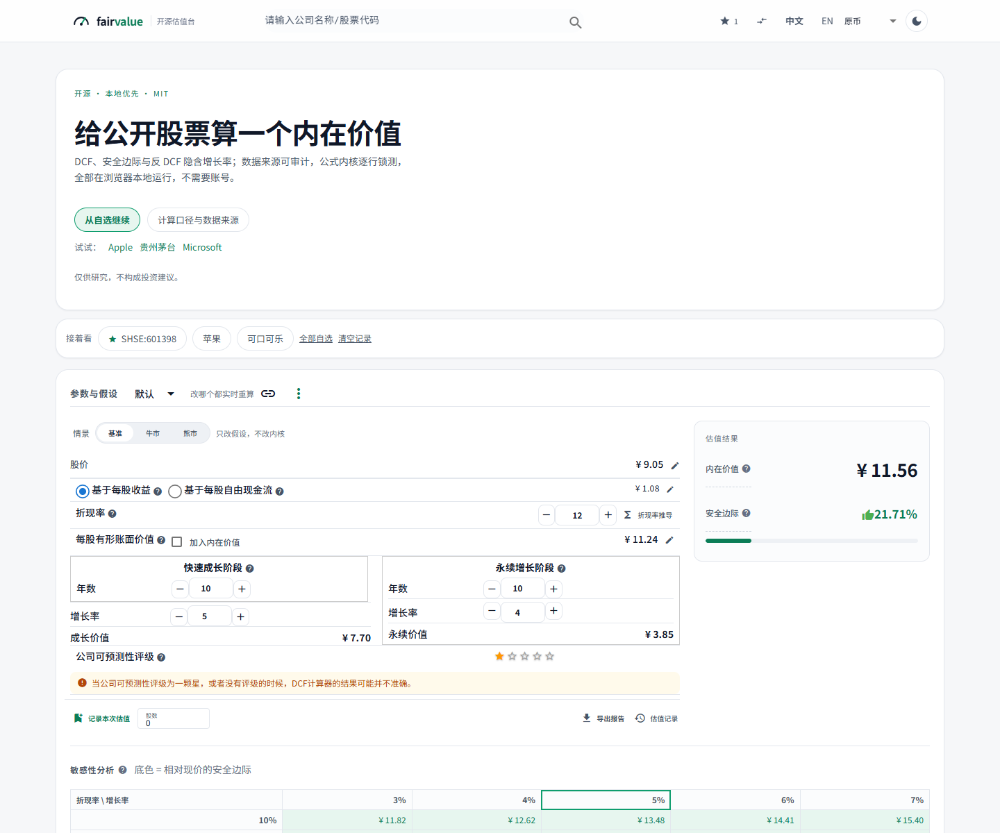
</p>
<p align="center">
  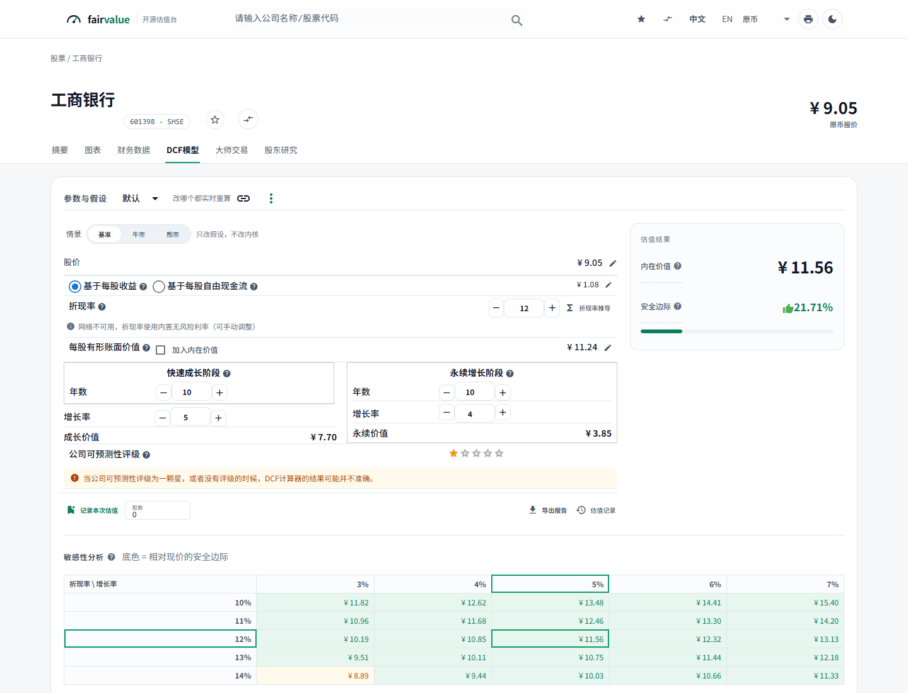
</p>
<p align="center">
  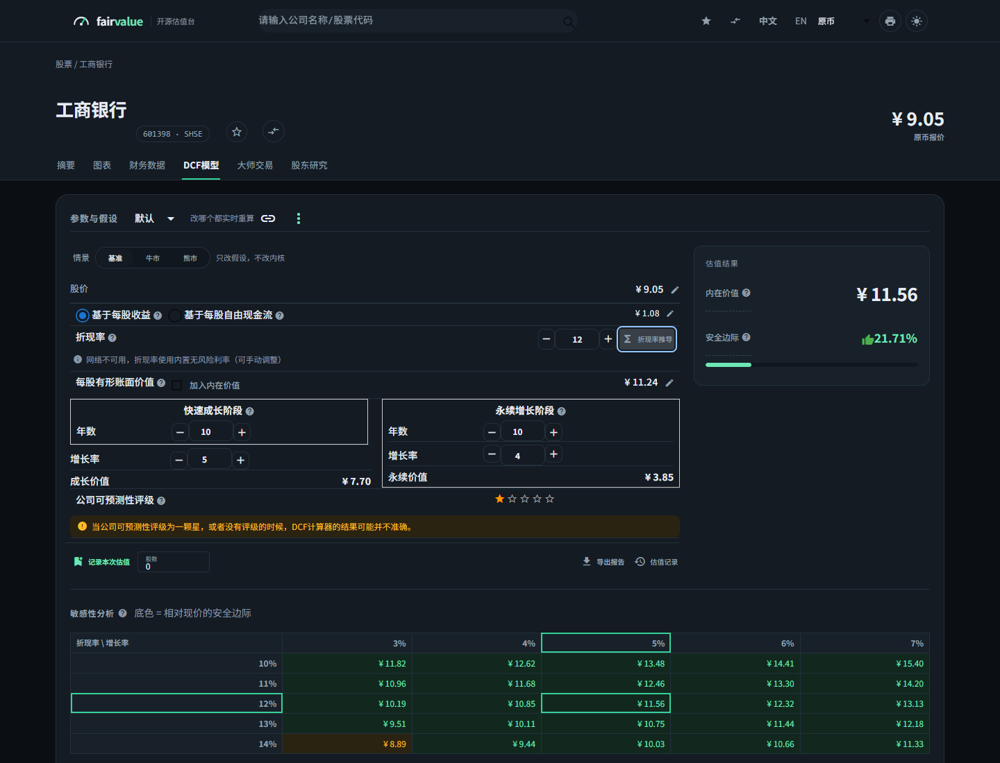
  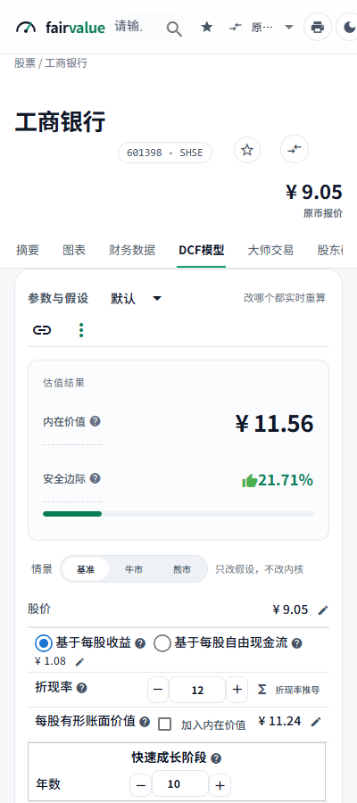
</p>

- Runs entirely in your browser: no account, no server, no telemetry.
- Static build, deployable to GitHub Pages in one workflow.
- Every data source is declared, ordered, metered and reported: a fallback is announced, never silent.
- Every metric that cannot be computed says *why* instead of printing `NaN`.

> Research tool, not investment advice.

## Features

- **Valuation**: fair value, margin of safety, fast-growth and terminal components, reverse DCF
  (the growth rate today's price implies), tangible book value toggle.
- **Inputs**: EPS or free-cash-flow basis, discount rate (bounded 0–50), growth windows, terminal
  assumptions, editable price/book.
- **Provenance**: every number that can go stale says where it came from — the risk-free rate is
  marked live / cached / bundled where it is used, never silently replaced.

  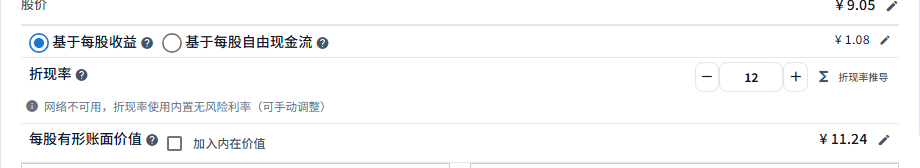

- **Share**: one link carries the assumptions you moved — pasted back, the page reopens on the same
  valuation (only the deltas travel, so the URL stays short).
- **Accessible by default**: a skip link, visible focus rings on every custom control, a debounced
  live region that announces each recalculation and AA-contrast muted text in both themes
  (`npm run audit:contrast`); reduced-motion preferences are respected.

- **Report**: export the same valuation as Markdown — assumptions, kernel outputs, the sensitivity
  grid, peers and the source provenance, ready to drop into a note.

- **Cases**: bull / base / bear presets that nudge the three assumption dials (assumptions only; the
  kernel is untouched and the base is restored on reset).

- **Rate build-up**: derive the discount rate from risk-free + beta × equity premium + size
  premium, then apply it into the bounded input.

- **Multiple cross-check**: P/E, P/FCF and P/BV with an editable target multiple, the implied
  price and the gap to the DCF fair value — a second opinion, never written back.

- **Peers** (quoted lazily, once the panel nears the viewport): the same quote for four listed peers, their median P/E and implied price next to the DCF
  fair value — a fourth opinion, also read-only.

  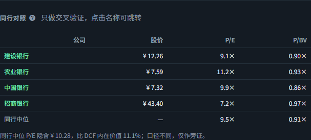

- **Sensitivity**: a 5×5 matrix around the current discount rate and growth rate, every cell
  re-run through the kernel, tinted by margin of safety.

  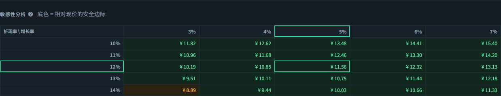
  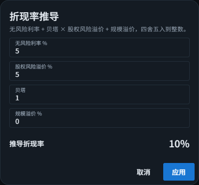
  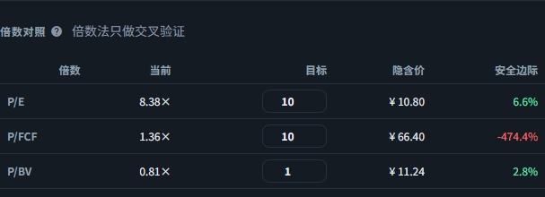

- **Tabs**: summary, chart, financials, ownership and the DCF model are separate routes over one
  symbol. The chart remembers its indicator per symbol, the financial table exports as CSV (TTM and
  quarterly columns can be dropped), switching tabs keeps the query, and the one remaining reference
  tab (institutional trades) says it is a placeholder instead of doing nothing.

  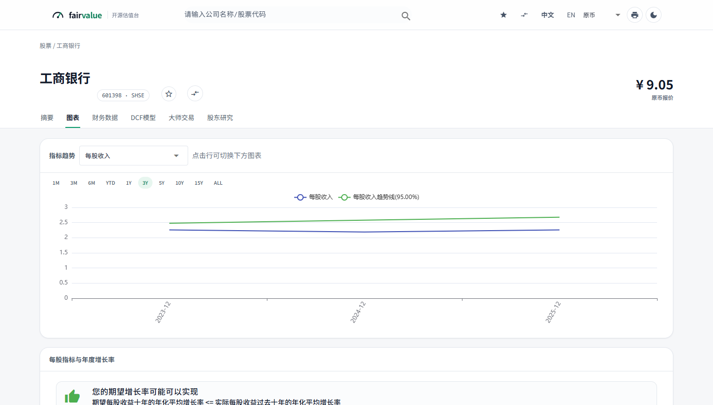
  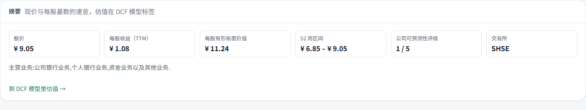

- **Lazy charts**: the ECharts bundle (157 kB gzip) only loads once the chart panel nears the viewport, and
  printing pulls it in through `beforeprint`.
- **Evidence**: per-share growth table (10y / 5y / 1y plus annual, TTM and last-quarter values),
  indicator chart with trend line, click a row to switch the chart.
- **Offline shell**: a service worker keeps the app shell and whatever it served, so a reload without the
  network still opens the UI and the committed snapshots; live quotes wait for the connection. It is
  installable (manifest + PNG icons rendered by `npm run icons`).
- **Survives blocked storage**: with cookies/localStorage disabled the app still boots and keeps the watchlist
  and settings for the session in memory; nothing hard-depends on persistence.
- **Print / save PDF**: a print button on stock pages and the comparison hides the chrome for the print media and
  leaves the valuation, assumptions and evidence (or the comparison table); nothing is uploaded to render it.

  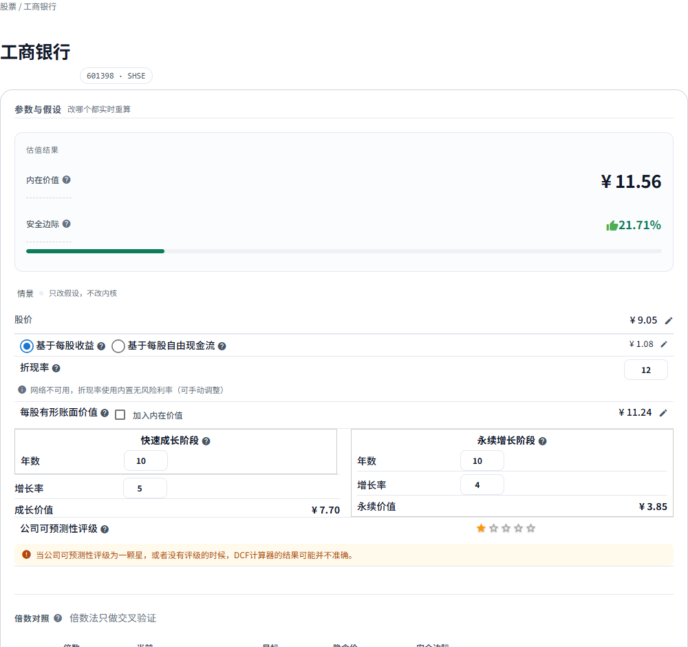

- **Side-by-side compare**: up to five symbols under one shared set of default assumptions, ranked by margin of
  safety, fed from the watchlist, a header toggle on any stock or by typing a code (bare codes work); the queue lives on the
  device and a bare `#/compare` picks it back up; a copy-link button hands the whole comparison on, and a
  typo or a repeat gets told rather than silently ignored, and failed quotes offer one retry.

  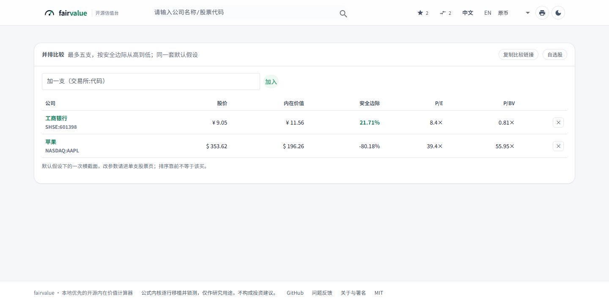

- **A useful 404**: a wrong code still lists the format, the exchanges and three live example names to jump into.
- **Keyboard `/` shortcut**: pressing `/` anywhere outside a field jumps to the symbol lookup.
- **Two languages**: the first visit follows the browser language (Chinese or English) and the header switch is
  remembered; every string is translated, dates and numbers localised.
- **Symbol suggestions**: the header search offers a short datalist of well-known codes, so the `EXCHANGE:CODE`
  format does not have to be memorised.
- **Landing page**: the root explains what the tool does, offers example symbols and a way back to
  the watchlist, example symbols that rotate daily, and a single "pick up where you left off" card
  that puts starred stocks ahead of recent ones, with the default example calculator below.
- **Watchlist**: star a stock from its header, find it again from the star in the site header, and
  remove it from the list — local only, no account, newest first. Each row carries price, P/E and
  the calculator's own default fair value and margin of safety. The list exports to and imports
  from JSON or a CSV column, so it can move between devices or come out of a spreadsheet; an empty file says
  nothing was importable; if a quarterly snapshot answered, its date is shown instead of pretending it is live;
  if every quote fails the rows say so and a retry button re-asks.

  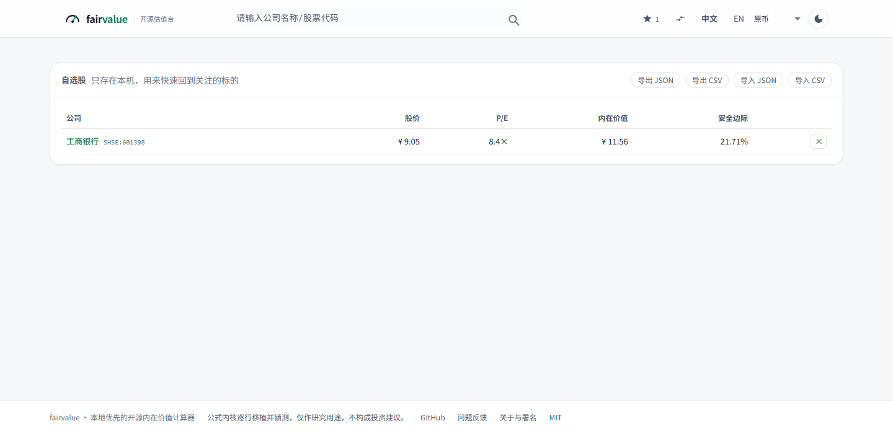

- **About**: where the data comes from, the CORS gateway, the MIT licence, the source order, and the
  kernel/deviations rules — plus links to the contributing and security docs.

  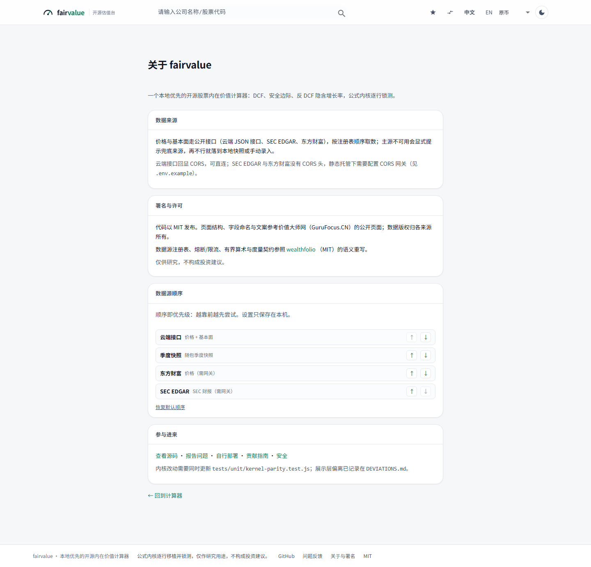

- **Trail**: record a valuation (optionally with a share count) and read back value return, TWR,
  XIRR, max drawdown and volatility — or the reason a metric is not applicable.
- **Workspace**: market whitelist over six exchanges, header symbol lookup, display currency with
  explicit FX, editable data-source order plus a per-symbol pin, light/dark theme, and a zh-Hans / English UI that
  covers the chrome as well as the calculator (banners, 404, About, record panel).

  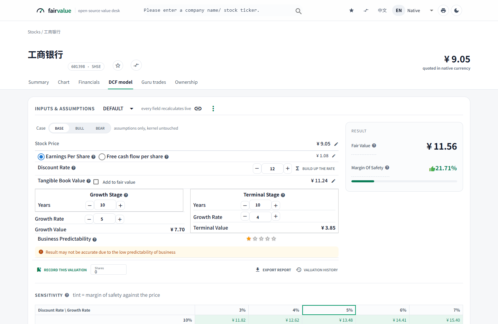

## Supported symbols

`EXCHANGE:CODE` — or just the bare code, which the box maps by shape (`601398` → SHSE, `000858` → SZSE,
`0700` → HKSE, `AAPL` → NASDAQ). Explicit form: `SHSE:601398`, `SZSE:000001`, `HKSE:0700`（港股前导零可省）, `NYSE:KO`, `NASDAQ:AAPL`, `AMEX:…`.
The whitelist lives in `src/config/markets.js`; anything else lands on a not-found page that shows the format.

## Run it

```bash
npm install --legacy-peer-deps
npm run dev          # http://127.0.0.1:5173
```

Useful env (see `.env.example`): `VITE_API_MODE=fixture` for a fully offline demo,
`VITE_US_SOURCE=auto|hybrid|edgar|eastmoney` to order US sources, `VITE_TRANSPORT`
(`proxy` in dev, `direct` in builds), `VITE_CORS_GATEWAY` for static hosts and `VITE_SITE_URL` for the canonical/OG origin when not on `*.github.io`.

## Deploy to GitHub Pages

1. Push to `main` (or `master`) with Pages enabled (Settings → Pages → Source: GitHub Actions).
2. There is **one workflow**, `.github/workflows/pages.yml`. On push it runs lint, unit tests, a
   static-host smoke check, a Pages build with `VITE_BASE` / `VITE_SITE_URL` derived from the
   repository, then deploys `dist`. The heavy browser suites (Playwright, contrast, base-path,
   rehearsal) run **on pull requests only** — this keeps Actions minutes low on data pushes.
3. The published site does not call quote or filing hosts. Refresh `public/data/` on your
   machine with `npm run snapshot`, commit those files, and push. Routing uses hash history, so
   deep links work without rewrite rules.

### Data contract — read this before adding editable inputs

The committed snapshots in `public/data/` are the **single source of fundamental truth** for the
published site. They are refreshed locally on a schedule (`npm run snapshot`) and pushed; the
browser never fetches EPS, cash flow, book value or growth rates from a live source.

| Field group | Editable in the browser? | Where it changes |
|---|---|---|
| Price | Yes | Typed over on the page; snapshot price is only a seed |
| Valuation assumptions — discount rate, growth, terminal growth, horizons, target multiples | Yes | User judgment, recomputed locally |
| Fundamentals — EPS, free cash flow per share, tangible book, growth history, predictability | **No** | `npm run snapshot` locally, then commit and push |
| Manual mode | Yes, all fields | Fallback only, when every data source failed |

Do not add an inline editor for a fundamental field. Doing so desynchronises the page from the
committed snapshot and contradicts the data contract above. If a value is wrong, fix the upstream
parse in `src/data/providers/` and regenerate the snapshot.

Refresh the published numbers locally, then commit and push:

```bash
npm run snapshot
```

That rewrites `public/data/<EXCH>-<CODE>.json` and `public/data/catalog.json`. The page shows
「季度快照 · 数据截至 …」 and recalculates fair value in the browser from the current price and
assumptions. The US Treasury rate still loads directly when the browser can reach it.

`npm run rehearse:pages` builds under `/valueprobe/` twice — with snapshots and with
`VITE_SNAPSHOT=off` — and asserts the app still works with no same-origin API, that the offline
source disappears when compiled out, and that a dead primary source ends in a readable banner
rather than a skeleton. It runs on PRs, not on every push.

Before publishing a fork, change the repo URL in `src/config/site.js` (footer and About page)
and the page name in `index.html`. Local development still proxies live quotes; the published
build does not.

## Tests

Run these locally before pushing — with the browser gates moved to PRs, your machine is the
first line of defence on data pushes:

```bash
npm run lint         # eslint (flat config): dead code, Vue essentials
npm run test         # vitest: kernel parity, registry, measurement, FX, formatting
npm run test:e2e     # playwright, bundled chromium, fully offline; axe on six routes
npm run smoke:pages  # build under /valueprobe/, serve, assert the static-host contract
npm run rehearse:pages  # both deploy builds (snapshot on / VITE_SNAPSHOT=off), served and asserted
npm run audit:contrast  # WCAG AA spot-check of the muted text in both themes
npm run build
```

E2E intercepts every request with `page.route`; nothing touches the network. The axe spec fails on serious or
critical violations, so a contrast or label regression cannot land silently.

## Layout

```
src/lib/dcf.js            formula kernel (red line: ported 1:1, tested)
src/lib/measure.js        TWR / XIRR / drawdown / volatility with quality codes
src/lib/{arith,fx,format} bounded maths, FX, display formatting
src/data/                 provider registry, breaker, limiter, validation, diagnostics
src/data/providers/       one module per source
src/store/                stock, dcf, source state machine, display currency
src/components/           calculator, table, chart, record panel, banner
tests/unit tests/e2e      unit and end-to-end suites
```

## Contributing

`CONTRIBUTING.md` has the house rules — the short one is that `src/lib/dcf.js` is a red line and every visible
difference from the reference page goes into `DEVIATIONS.md`. Bug reports are welcome with the commit hash and browser.

- [CONTRIBUTING.md](CONTRIBUTING.md) · [SECURITY.md](SECURITY.md) · [CODE_OF_CONDUCT.md](CODE_OF_CONDUCT.md)

## Documentation

| Doc | What |
| --- | --- |
| [DESIGN.md](DESIGN.md) | design system and layout decisions |
| [DATA_SOURCES.md](DATA_SOURCES.md) | source model, ordering, breaker, adding a provider |
| [CALCULATION.md](CALCULATION.md) | measurement contract and reason codes |
| [DEVIATIONS.md](DEVIATIONS.md) | where this differs from the original page, and why |
| [HANDOVER.md](HANDOVER.md) | cognitive-cost review and a refactor plan for a new maintainer |
| [docs/ARCHITECTURE.md](docs/ARCHITECTURE.md) | layers, dependency direction, vocabulary and persistence keys |
| [ATTRIBUTION.md](ATTRIBUTION.md) | attributions and data terms |

## License

MIT for the code (`LICENSE`). Market data stays under its sources' terms — see `ATTRIBUTION.md`.
